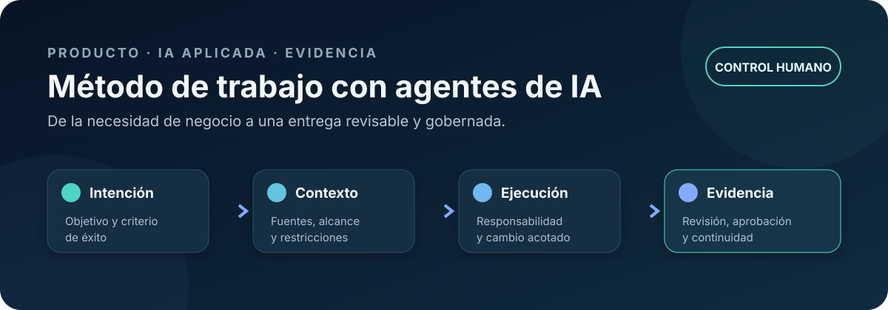
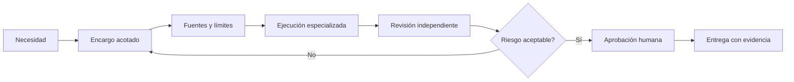

# Método de trabajo con agentes de IA



> Un sistema operativo para convertir una necesidad de negocio en trabajo asistido por IA que pueda revisarse, aprobarse y explicarse.

[Visión ejecutiva](#en-30-segundos) · [Modelo operativo](docs/modelo-operativo.md) · [Calidad y evidencia](docs/calidad-y-evidencia.md) · [Riesgo y control humano](docs/riesgo-control-humano.md) · [Plantillas](#plantillas-reutilizables)

## En 30 segundos

| Pregunta | Respuesta |
| --- | --- |
| ¿Qué problema resuelve? | La pérdida de contexto, responsabilidad y trazabilidad cuando varios agentes colaboran sobre un mismo objetivo. |
| ¿Qué aporta? | Encargos acotados, fuentes declaradas, roles claros, revisiones por riesgo y evidencia de aceptación. |
| ¿Cuál es el papel humano? | Define el objetivo, decide los límites y aprueba los cambios con impacto material. |
| ¿Qué papel desempeño? | Conceptualizo el sistema de trabajo, traduzco necesidades de negocio a decisiones de producto y coordino la ejecución técnica asistida por IA. |
| ¿Qué no promete? | Autonomía total, ausencia de errores ni controles que el proyecto no haya implementado y verificado. |

Este repositorio documenta un método, no un producto de IA empaquetado. Su valor está en hacer visible **cómo se decide, cómo se ejecuta y cómo se demuestra** que una entrega cumple el encargo sin exceder sus límites.

## La idea central

Un agente no recibe solo una instrucción. Recibe una unidad de trabajo gobernada:

1. **Intención** — resultado esperado y criterio de éxito.
2. **Contexto** — fuentes permitidas, restricciones y estado conocido.
3. **Responsabilidad** — rol, alcance y archivos o sistemas que puede tocar.
4. **Control** — nivel de riesgo, revisión y aprobación requerida.
5. **Evidencia** — cambios, verificaciones, límites y siguiente paso.



La revisión puede ser realizada por otra persona, otro agente o el mismo responsable en un pase separado. Lo importante es que el criterio y la evidencia no queden mezclados con la generación inicial.

## Del prompt a la operación

- Traduce objetivos ambiguos a entregables observables.
- Separa coordinación, ejecución, revisión y aceptación.
- Limita las fuentes y la superficie de cambio antes de actuar.
- Exige declarar qué se sabe, qué se supone y qué falta.
- Conserva evidencia suficiente para retomar o auditar el trabajo.
- Ajusta la aprobación humana al riesgo, no al entusiasmo por automatizar.

### Tres niveles de garantía

Cada control debe etiquetarse sin exagerar su madurez:

| Nivel | Qué significa | Ejemplo |
| --- | --- | --- |
| **Regla documentada** | Existe una política explícita que orienta el trabajo. | “No publicar datos del cliente”. |
| **Control mecánico** | Una herramienta, permiso o prueba impide o detecta automáticamente una desviación. | Detector de secretos en integración continua. |
| **Verificación humana** | Una persona contrasta el resultado y su evidencia antes de aprobar. | Revisión de confidencialidad previa a publicación. |

Una regla escrita **no equivale** a un control automático. Una comprobación automática **no sustituye** el juicio sobre contexto, producto o impacto.

## Modelo operativo

El método usa responsabilidades, no una colección fija de personajes. En un proyecto pequeño una persona puede asumir más de un rol, siempre que conserve pases separados y evidencias claras.

| Responsabilidad | Pregunta que responde | Entregable principal |
| --- | --- | --- |
| Producto y coordinación | ¿Qué resultado merece construirse y bajo qué restricciones? | Encargo priorizado y decisión de aceptación. |
| Análisis de dominio | ¿Qué significa correctamente la necesidad? | Reglas, escenarios y ambigüedades resueltas. |
| Ejecución especializada | ¿Cómo se produce el cambio dentro del alcance? | Artefacto o modificación verificable. |
| Revisión técnica | ¿Es coherente, mantenible y segura la solución? | Hallazgos y decisión razonada. |
| Calidad y validación | ¿Cumple los criterios y evita regresiones relevantes? | Evidencia de pruebas y excepciones. |
| Documentación | ¿Puede entenderse, usarse y retomarse? | Guía, registro y traspaso. |

La [matriz RACI y el ciclo completo](docs/modelo-operativo.md) muestran cómo escalar estas responsabilidades sin perder una única dirección de producto.

## Anatomía de un encargo fiable

```text
Objetivo       Resultado que se busca, expresado como cambio observable.
Contexto       Estado actual y fuentes autorizadas.
Alcance        Artefactos incluidos y excluidos.
Decisiones     Supuestos resueltos y preguntas todavía abiertas.
Riesgo         Daño posible, reversibilidad y aprobación necesaria.
Criterios      Condiciones concretas para aceptar la entrega.
Evidencia      Pruebas, revisión, diferencias y límites encontrados.
Traspaso       Estado final, deuda conocida y siguiente acción segura.
```

La plantilla completa está en [`templates/encargo.md`](templates/encargo.md). Un ejemplo sin datos de cliente puede verse en [`examples/encargo-anonimizado.md`](examples/encargo-anonimizado.md).

## Controles que acompañan al trabajo

- **Contexto y fuentes:** se declara qué documentos gobiernan y cuáles solo informan.
- **Privacidad:** se minimizan datos, se excluyen secretos y se anonimiza la evidencia pública.
- **Coste:** se limita el número de iteraciones, la profundidad y el uso de modelos según el valor esperado.
- **Calidad:** cada criterio de aceptación apunta a una comprobación reproducible o a una revisión identificada.
- **Reversibilidad:** antes de cambiar datos, permisos o producción se define copia, rollback o recuperación.
- **Continuidad:** el traspaso registra estado, riesgos y siguiente paso sin depender de memoria conversacional.

Consulta [calidad y evidencia](docs/calidad-y-evidencia.md) y [riesgo y control humano](docs/riesgo-control-humano.md) para el detalle.

## Patrones de aplicación

- **ABYSS:** conceptualización de producto, arquitectura funcional y documentación de una plataforma de gestión en entorno regulado.
- **Sistema de gestión confidencial:** traducción de procesos reales a producto, coordinación desde el descubrimiento hasta la puesta en marcha y acompañamiento a usuarios. La capa de IA integrada permanece en desarrollo y pruebas; no se presenta como funcionalidad productiva.
- **Cadena documental:** transformación controlada de fuentes estructuradas a entregables revisables, con validación visual y trazabilidad.
- **Organización de conocimiento:** clasificación de fuentes, límites de contexto y reglas para que distintos agentes trabajen sin duplicar el original.

Los [casos anonimizados](docs/casos-anonimizados.md) explican el patrón, la decisión y la evidencia sin revelar información operativa.

## Plantillas reutilizables

| Plantilla | Momento de uso |
| --- | --- |
| [Encargo](templates/encargo.md) | Antes de ejecutar: objetivo, alcance, fuentes, riesgo y aceptación. |
| [Traspaso](templates/traspaso.md) | Al cambiar de responsable o cerrar una sesión. |
| [Revisión](templates/revision.md) | Para contrastar el resultado con criterios y límites. |
| [Aceptación](templates/aceptacion.md) | Para registrar la decisión humana y las excepciones. |

## Lectura por profundidad

| Si quieres… | Empieza por… |
| --- | --- |
| Entender el enfoque en dos minutos | Este README |
| Implantar el flujo en un equipo | [Modelo operativo](docs/modelo-operativo.md) |
| Diseñar pruebas y registros | [Calidad y evidencia](docs/calidad-y-evidencia.md) |
| Definir aprobaciones por impacto | [Riesgo y control humano](docs/riesgo-control-humano.md) |
| Publicar un caso sin exponer al cliente | [Confidencialidad y publicación](docs/confidencialidad-publicacion.md) |
| Conocer los límites reales | [Principios y límites](docs/principios-y-limites.md) |

## Límites de madurez

Este repositorio presenta un marco operativo contrastado en proyectos propios, no un estándar certificado ni una plataforma que garantice su cumplimiento por sí sola. La madurez real depende de la implementación de cada equipo:

- algunas reglas pueden automatizarse con permisos, pruebas y validadores;
- otras requieren revisión humana por contexto o responsabilidad;
- las evidencias públicas están anonimizadas y no permiten reproducir sistemas privados;
- no se publican métricas que no puedan justificarse;
- la calidad del resultado sigue condicionada por las fuentes, los criterios y la supervisión.

## Autor

**Robert Garabán** — Product Owner y consultor de IA aplicada. Trabajo en la intersección entre procesos, producto y ejecución técnica: conceptualizo el sistema, traduzco necesidades y coordino entregas que puedan verificarse.

[Perfil profesional en LinkedIn](https://www.linkedin.com/in/robertgaraban/)

---

Para adaptar el método, empieza por copiar el [encargo](templates/encargo.md), asigna un nivel de riesgo y decide de antemano qué evidencia será suficiente.
