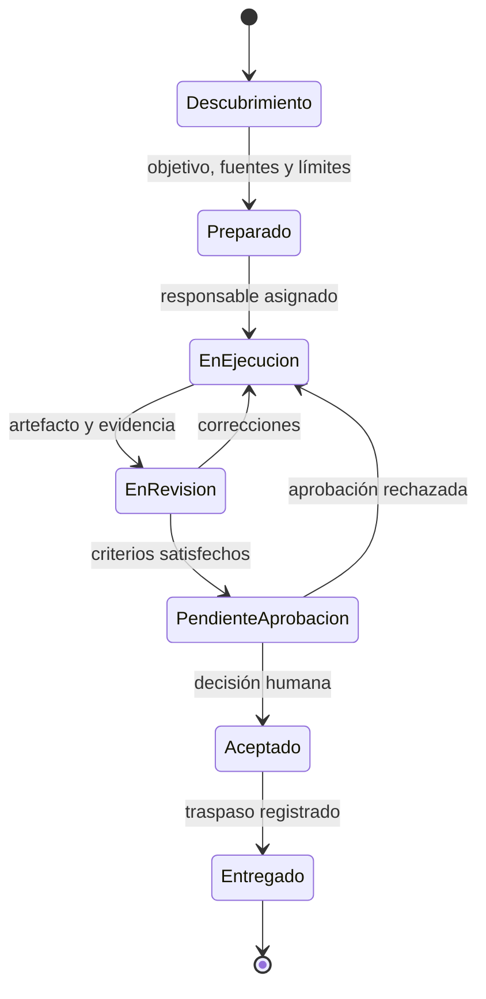

# Modelo operativo

[← Principios](principios-y-limites.md) · [Inicio](../README.md) · [Calidad y evidencia →](calidad-y-evidencia.md)

## Ciclo de vida

No todas las tareas necesitan herramientas distintas para cada estado. Sí necesitan conservar su significado: nadie debería confundir una generación con una aceptación.

## Responsabilidades

- **Producto y coordinación:** formula resultado, prioriza, resuelve dependencias, integra conclusiones y obtiene aprobación.
- **Análisis de dominio:** traduce la operación a reglas, escenarios, excepciones y preguntas.
- **Ejecución especializada:** realiza el cambio en el alcance, usa fuentes autorizadas y aporta pruebas.
- **Revisión técnica:** contrasta diseño, seguridad, mantenibilidad y consecuencias no cubiertas.
- **Calidad y validación:** enlaza criterios con pruebas, comprueba recorridos y emite un veredicto sustentado.
- **Documentación:** adapta la explicación, registra decisiones y prepara continuidad.

## RACI orientativa

**R** realiza · **A** acepta · **C** aporta criterio · **I** recibe el resultado

| Actividad | Producto | Dominio | Ejecución | Revisión | Calidad | Documentación |
| --- | --- | --- | --- | --- | --- | --- |
| Definir resultado y prioridad | A/R | C | C | I | I | I |
| Resolver reglas del proceso | A | R | C | C | I | I |
| Preparar el cambio | A | C | R | C | C | I |
| Revisar la solución | A | C | C | R | C | I |
| Validar criterios | A | C | C | C | R | I |
| Aprobar impacto material | A | C | I | C | C | I |
| Documentar y transferir | A | C | C | C | C | R |

La tabla asigna responsabilidad funcional, no organigrama. En equipos reducidos una persona puede ocupar varias columnas. Conviene separar al menos los momentos de generación, revisión y decisión.

## Cuatro fronteras

1. **Funcional:** comportamiento o decisión que se cambia.
2. **Documental:** fuentes que gobiernan el trabajo.
3. **Técnica:** artefactos, permisos o entornos incluidos.
4. **Temporal:** estado aceptado al cierre y trabajo posterior.

## Paralelismo seguro

El paralelismo aporta valor cuando las tareas tienen resultados independientes, no escriben sobre los mismos artefactos, comparten una definición estable y pueden integrarse con criterios explícitos. El coordinador conserva el mapa de dependencias y cierra cada traspaso.

## Operación mínima

1. Copiar la [plantilla de encargo](../templates/encargo.md).
2. Asignar producto, ejecución y un pase de revisión.
3. Definir entre uno y tres criterios observables.
4. Acordar evidencia y aprobación.
5. Cerrar con [traspaso](../templates/traspaso.md) y [aceptación](../templates/aceptacion.md).
